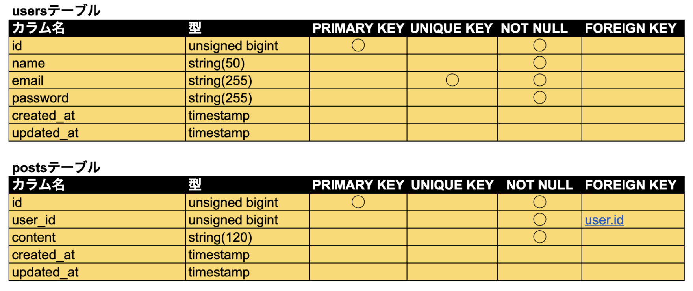
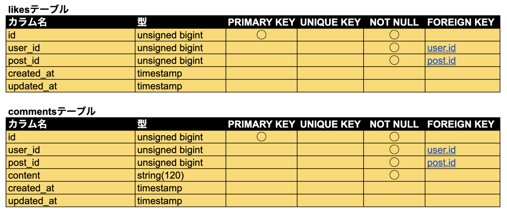
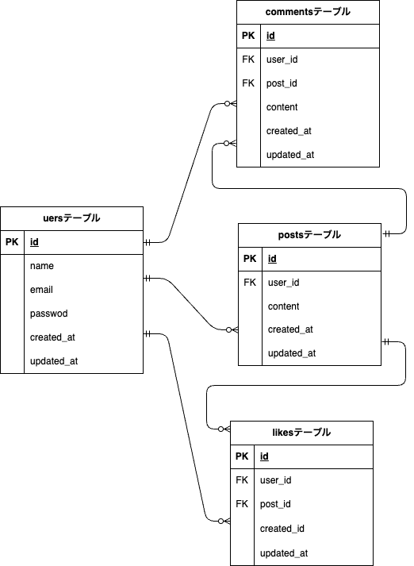

# Laravel Nuxt SNS

## アプリ概要
Firebase認証を利用したSNSアプリです。

## 作成した目的
Firebase Authentication を利用した認証機能と、Laravel API・Nuxt を組み合わせたSPA開発を学習するために作成しました。

## 使用技術（実行環境）

### Frontend
- Nuxt 4
- TypeScript
- Vue 3
- VeeValidate
- Firebase Authentication

### Backend
- Laravel
- MySQL
- Firebase Admin SDK

### Infrastructure
- Docker

## 主な機能
- ユーザー登録
- ログイン
- ログアウト
- 自動ログイン
- 投稿作成
- 投稿一覧表示
- 投稿詳細表示
- 投稿削除
- コメント投稿
- コメント表示
- いいね追加
- いいね解除

## テーブル設計



## ER図


## 環境構築
### Backend
```bash
cd backend2/src
composer install
cp .env.example .env
php artisan key:generate
```
### Frontend
```bash
cd frontend2
npm install
npm run dev
```

### Firebase
Firebase Authentication を使用しています。
利用する場合は Firebase プロジェクトを作成し、環境変数を設定してください。

### GitHub
https://github.com/mihonitou/laravel-nuxt-sns2

